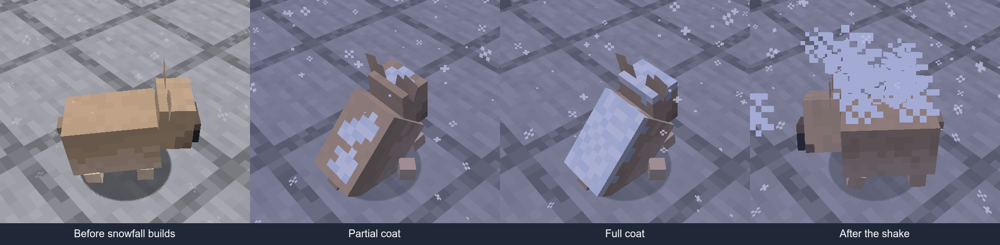

# Frenchies

Take a French bulldog on your next expedition. It can ride on the bow while you row, carry a bundle to a friend in another dimension, and lead you back to the spot where you dropped your gear. Bring glow berries. Your courier has been known to linger after a delivery.

**Standalone Fabric and NeoForge mod for Minecraft Java 26.1, 26.1.1, 26.1.2, and 26.3.** Install the same Frenchies jar on the client and server. For either 26.1 hotfix, choose the 26.1 jar for your loader. Fabric requires Loader 0.19.5 or later and Fabric API for your Minecraft version.

Jars use `frenchies-<minecraft-version>-<loader>-<mod-version>.jar`, for example `frenchies-26.3-neoforge-0.0.1.jar`.

| Minecraft Java | Frenchies jar line | NeoForge tested | Fabric API tested with Loader 0.19.5 |
| --- | --- | --- | --- |
| 26.1 | 26.1 | 26.1.0.19-beta | 0.145.1+26.1 |
| 26.1.1 | 26.1 | 26.1.1.15-beta | 0.145.4+26.1.1 |
| 26.1.2 | 26.1 | 26.1.2.129 | 0.148.0+26.1.2 |
| 26.3 | 26.3 | 26.3.0.101 | 0.165.2+26.3 |

## Meet your Frenchie

Frenchies come in fawn and brindle. To meet one in Creative, use the Frenchie Spawn Egg. Offer a bone to tame it, then right-click with an empty hand to switch between sitting and following. Feed two adult Frenchies glow berries to breed a pup.

Use `/summon frenchies:frenchie` or `/give @s frenchies:frenchie_spawn_egg` to meet one by command. Worlds saved with the earlier `florafauna` IDs need a separate migration to retain their existing dogs, equipment and courier data.

Tamed Frenchies stay healthy through ordinary hazards and never need healing. They react to danger, try to get clear, and can return to you for safety. A following dog catches up after ordinary separation. A dog you ask to sit waits there until called or until it needs rescuing.

Taming your first dog gives you a **Frenchie Whistle**. Right-click to call your selected Frenchie, or crouch and right-click to dismiss it until next time. Type `/frenchie select` and click a name to choose among your dogs, even while they are away. Use `/frenchie whistle` for a free replacement. Calls work across dimensions and interrupt jobs. A recalled courier keeps its parcel for you to collect with an empty hand. Move to open, dry ground if your dog can't land. Active dogs rejoin you after respawn. Dismissed dogs wait for your whistle.

- **Play fetch.** Craft a squeaky toy with orange wool and a slimeball. Right-click to squeak it and watch the ears turn your way. Squeak a few times to draw a small audience, or crouch and right-click to throw it. When your dog brings it back, right-click with an empty hand to take it.
- **Blow bubbles.** Craft a bubble toy with a glass bottle, a slimeball and a stick in any arrangement. Right-click to blow a small fan of bubbles. Up to three nearby Frenchies can join in. A sitting dog watches from its spot, and a lucky hunter might catch one on its nose. You can blow another group after two seconds.
- **Watch a Frenchie tease a slime.** Give an idle dog and a tiny slime a little room on level ground. The dog cocks its head, barks, bows and hops from side to side, then circles for another invitation. The slime can go about its business the whole time.
- **Share a little celebration.** A completed fetch or delivery, a reunion, or reaching a destination can earn a brief bow. The dog is still free to follow you.
- **Ask for a trick.** Crouch and use a bone on your Frenchie to see its ambitious attempt at a backflip. Give it room for the victory lap.
- **Offer belly rubs.** Crouch beside an idle Frenchie with empty hands for a moment, then use an empty hand to rub its belly. Walk away or give a command when playtime is over.
- **Watch the drying routine.** After a real swim, a Frenchie shakes off and may roll on nearby grass or moss before dragging its belly forward.
- **Play in snow.** On safe, shallow snow, a Frenchie may briefly dive and plow. A nearby snowball landing can also catch its attention.
- **Bring a digging assistant.** Dig nearby dirt or sand with a shovel and an available Frenchie may dig beside you, then proudly carry its reusable toy stick. Its digging leaves the ground untouched.
- **Take the boat.** Board with your dog following and it rides at the bow, leaving the passenger seat free. Its life jacket appears automatically on the water. When you step out, it looks for a safe landing.
- **Follow its nose.** Use an ordinary compass or a recovery compass on your dog and follow it toward your last death in this dimension. It waits if you fall behind and signals when you reach the spot.
- **Explore with a map.** Use a structure explorer map on your Frenchie to let it lead the way to the map's marked destination. Structure guidance requires a map supplied by the owner; the dog does not independently discover structures. Use the same map again to stop, or use another map to change destinations. The dog carries its own satchel and wears pirate gear for buried treasure. If it can verify the chest and reach the ground above it, it shows you where to dig.
- **Listen for two barks.** An awake Frenchie turns toward a visible creeper within 12 blocks. A green creeper face flashes with each bark, even above the hotbar when you're carrying the dog. Warnings have an eight-second cooldown.
- **Share a bedtime.** Use a bed within ten blocks of your dog and it can curl up by your pillow, even after a sit order. Each time it falls asleep, it may settle on its belly or roll onto its side. Sleep through the night together for two minutes of **Well Rested** and 10% faster block breaking.

## Out with your Frenchie

In falling snow, a dusting spreads across your Frenchie's head and back over about 20 seconds. Step under a roof and the coat melts over roughly half a minute, faster beside a lit campfire. An occasional shake scatters the snowflakes, and the coat starts building again if it's still snowing. Rain-soaked Frenchies shake off droplets and gradually dry in shelter.

- **Weather a storm together.** A nearby lightning strike can send a following dog to your side with a quiet whimper. It settles down about 15–30 seconds after the last nearby strike. A dog you asked to sit holds its place.
- **Lead a herd.** Walk with wheat in either hand while sheep or cows follow. Your Frenchie works along the outside and can gently nudge a straggler on clear, level ground. Put the wheat away to end the help.
- **Bring home a stick.** After you chop a log, your dog may pick up one freshly dropped stick once nearby players step away. It brings the stick to your inventory and leaves saplings for replanting. If your inventory is full, take the stick from its mouth with an empty hand.
- **Take a breather.** Watch a standing Frenchie closely and you can see its ribs rise and an ear twitch. Stay still for a while and your dog may sit beside you, then stretch out. It favors a sheltered spot. Start walking and it gets up on its own.
- **Explore a ravine.** If a fall costs you at least two hearts, a Frenchie within 24 blocks may come check on you. If it can't find safe footing down, it looks toward you from where it stands. At an exposed lava edge, it looks for room to back away and can wait back while you mine.

## Adventure outfits

Frenchies automatically dress for the trip. The captain wears a cap and life jacket at the bow. When you dive with enough water overhead, a following Frenchie can enter from a nearby bank and swim to you in a clear rectangular helmet, four flippers, and a small air tank. It returns to surface swimming when you come up.

In dark caves a Frenchie puts on a hard hat, keeps close, and sometimes looks at ore or watches you use a pickaxe. For the lamp to illuminate nearby terrain, install the matching [LambDynamicLights](https://modrinth.com/mod/lambdynamiclights) client mod on Fabric or NeoForge. The server needs only Frenchies. The lamp provides constant level-11 point light and makes no changes to world blocks.

A snowy biome brings out boots and a scarf wrapped around the shoulders. Exposed snowfall gradually collects on the coat and melts under cover or in warmer surroundings. Frenchies sometimes shake off snow or rain, and a nearby thunderclap can send them back to their owner with a soft whimper. A dog asked to stay keeps its place.

In the Nether, the backpack fan speeds up near lava and a following dog waits if you venture too close to a lava edge. In the End, a Frenchie wears a square white helmet with an antenna and ducks when a flying dragon passes overhead. A dog carried in a front pack wears its aviator outfit during Elytra or Happy Ghast flight and keeps its goggles on for a moment after landing.

## Send a special delivery

Use a bundle on your Frenchie, choose an online player or **Your bed**, check the arrival estimate, and select **Send**. A trip of 160 blocks takes about 17 seconds at normal server speed. Couriers can cross dimensions without loading terrain along the route.

At the recipient's feet, the Frenchie sits with the parcel on display. Right-click with a free inventory slot to accept it. The dog looks up for a moment. A glow berry earns a happy bounce, and it heads home either way. For a bed delivery, the dog waits at your bed until you collect the bundle with an empty hand.

Use `/frenchie recall` anywhere to call back traveling or waiting dogs, including any unaccepted parcels. To send a dog home on its own, use `/frenchie home` within 12 blocks of it, or crouch and right-click your bed with an empty hand.

## Carry your copilot

Craft a Frenchie Front Pack with string in the left and right squares of one row and three leather in the row below. Right-click the air with the pack to equip it on your chest. Crouch and right-click your adult Frenchie to pick it up, then crouch and right-click the air to set it down. Carrying pauses its current job.

On a quiet nighttime walk, your passenger can close its eyes, lower its head, and let out an occasional soft snore. It perks up if you sprint, take flight, or it spots a creeper.

**Pick a color.** Combine the pack with any of the 16 dyes. Multiple dyes blend with the existing color. Wash the pouch in a water cauldron to restore its original color for one level of water.

**Give it wings.** Combine a front pack and an elytra anywhere in the crafting grid. Wear the winged pack on your chest to glide with your dog's head peeking out in front. The recipe keeps the dye, remaining wing durability, and enchantments from both items, taking the higher level for matching enchantments. You can still dye the pouch and repair the wings with a phantom membrane at an anvil.

**Wear it with armor.** A regular pack also fits the **Cape** slot in Trinkets Updated. On NeoForge it also fits the **Body** slot in Curios, or in Baubles 2 on Minecraft 26.1. If you wear two, the chest-slot pack supplies the visible color. Removing the last pack releases your dog when there's safe ground and room nearby. For NeoForge 26.1.0.19-beta, use Trinkets Updated 4.0.0-alpha.9+26.1.

## Companion settings

Fabric and NeoForge generate `config/frenchies.properties` on startup. The settings apply to every Frenchie on the server, or in your local game for singleplayer. All default to `true`. To lead livestock yourself, for example, set `automaticHerding=false` and restart. You can add any missing option to an existing file. Each dog's sit and follow orders still come from its owner.

| Option | Controls |
| --- | --- |
| `automaticAdventureOutfits` | Show automatic adventure outfits |
| `miningHelmetDynamicLight` | Illuminate nearby terrain when the hard hat is active and the client has LambDynamicLights |
| `snowAccumulation` | Let exposed snowfall collect on the coat and build up enough for a snow shake |
| `weatherReactions` | Rain and snow exposure, precipitation shakes, and thunder reactions |
| `visibleSnow` | Draw the accumulated snow on the coat |
| `thunderFear` | Seek company or cover after a lightning strike when `weatherReactions` is enabled |
| `automaticHerding` | Assisting sheep and cows that follow wheat |
| `fallReactions` | Checking on an owner who loses at least two hearts to a fall |
| `ambientCompanionship` | Voluntarily resting beside an idle owner and dozing in the front pack at night |
| `sideSleeping` | Choosing between the two sleeping poses. Set to `false` to always use the original belly-down pose |
| `lavaReactions` | Retreating before reaching an exposed lava edge |
| `stickRetrieval` | Fetching a dropped stick after tree chopping |

## Development

The [behavior decisions](docs/behavior-decisions.md) record the accepted scope and remaining ideas.

### Editing outfits in Blockbench

Open and save the editable `.bbmodel` files directly in the Frenchies checkout. Minecraft loads separate Java model code and runtime textures, so apply the corresponding changes there and check the outfit in-game before committing. [Blockbench outfit workflow](art/blockbench/adventure-outfits/Start%20Here.md)

### Building and testing

`FrenchieEntity` connects Minecraft interactions, goal priorities and synchronized entity state. The packages beneath `common.entity.frenchie` group the code by feature.

| Package | What lives there |
| --- | --- |
| `play` | Toys, fetch, tree-stick retrieval, bubbles, tricks, and shared play rules |
| `assistance` | Livestock herding and digging assistance |
| `travel` | Boat boarding and dismounting, and following a trail to the owner's last death |
| `delivery` | Courier trips, parcel handoffs, the destination picker, and its packets |
| `recall` | Whistle commands, companion selection, the saved roster, and legacy indexing |
| `rest` | Bedside behavior and the Well Rested effect |
| `weather` | Snow and rain exposure, shaking, and snow play |
| `reaction` | Creeper warnings, danger responses, owner concern, and quiet companionship |
| `client` | The Frenchie model, animations, and render layers |
| `frontpack` | Equipment, crafting, attachments, and accessory integration. Its `client` package owns rendering, HUD, and client input. |

Use Java 25 and this checkout's Gradle wrapper. The four Gradle projects use the form `:<minecraft-version>-<loader>`. For example, run `./gradlew :26.1-fabric:build :26.1-fabric:runGameTestServer` to build and test Fabric, or `./gradlew :26.3-neoforge:runClient` for a NeoForge development client. Run all four targets before a release. The spawn egg models and other runtime resources are checked in. Jars are under `versions/<minecraft-version>-<loader>/build/libs/`.

For the NeoForge scripted clients on Windows with PowerShell 7, run `./scripts/test_dev_world.ps1 -Target 26.1 -All -SourceWorld <closed-save-directory>` to check sleep, front-pack persistence, status icons and delivery with a real client. Use `-Target 26.3` for that version. Run `./scripts/test_delivery_multiplayer.ps1 -Target 26.1` to verify courier handoff between two real clients and a dedicated server, or `./scripts/test_playful_interactions.ps1 -Target 26.1` to inspect playful poses. These scripts accept either target and keep disposable worlds, logs and captures under `versions/<target>-neoforge/.tmp/`. Their default target is 26.1.

To play with FloraFauna, Hammer and Frenchies together, run `./gradlew -PdevMods=all :26.1-neoforge:runClient` or `:26.3-neoforge:runClient` from a matching FloraFauna checkout. [FloraFauna development setup](https://github.com/jeremyepling/florafauna#play-with-the-hammer-and-frenchies)

For companion reactions, run the NeoForge GameTests with `-PgameTestFilter=frenchies:companion_reaction_*`. The scripted client accepts `-Scenario weather` to capture the same dog as its snow coat builds, shakes off, and begins to build again.

Use `-PgameTestFilter=frenchies:adventure_*` for outfit and traversal GameTests. The scripted client accepts `-Scenario adventure` for outfits and cave light and `-Scenario adventureflight` for a packed Frenchie on a Happy Ghast.

Use `-Scenario rest` to see the standing idle and both sleep poses beside a bed, then watch the packed dog doze, snore, and wake for a creeper or daylight. The shared GameTest `frenchies:frenchie_sleep_pose_save` covers saved poses and older worlds.
